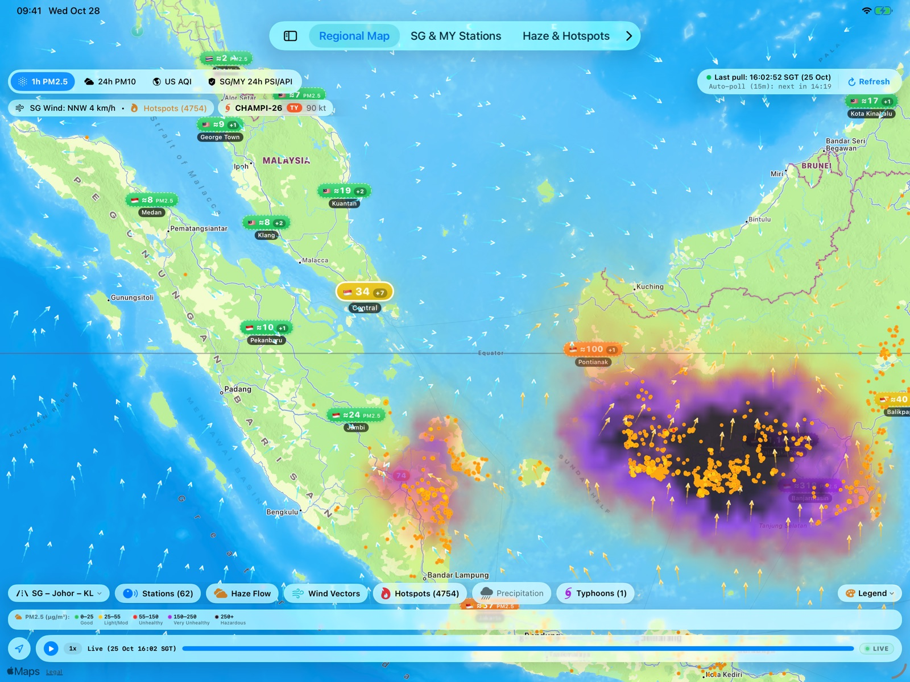
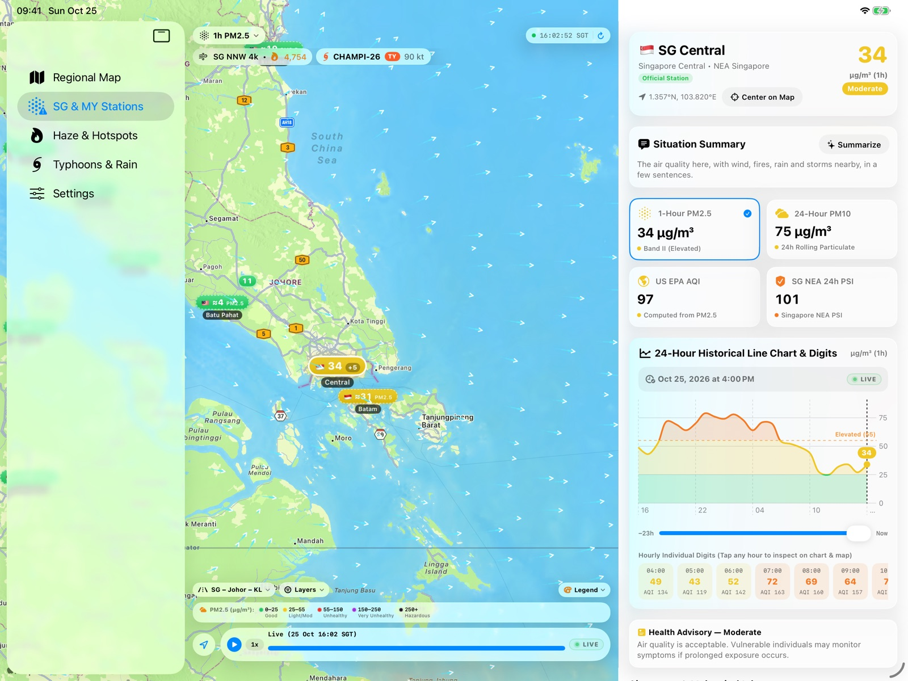
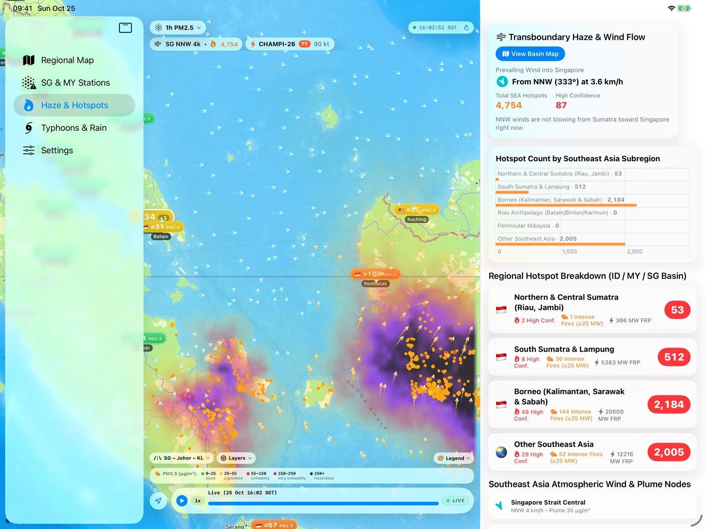
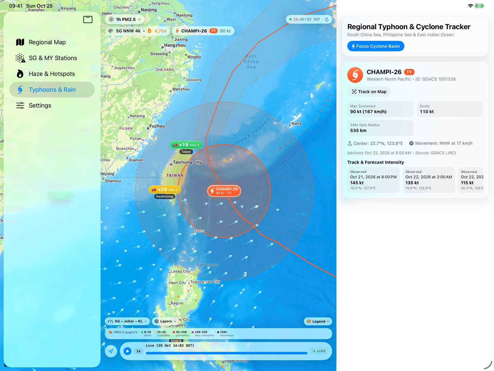
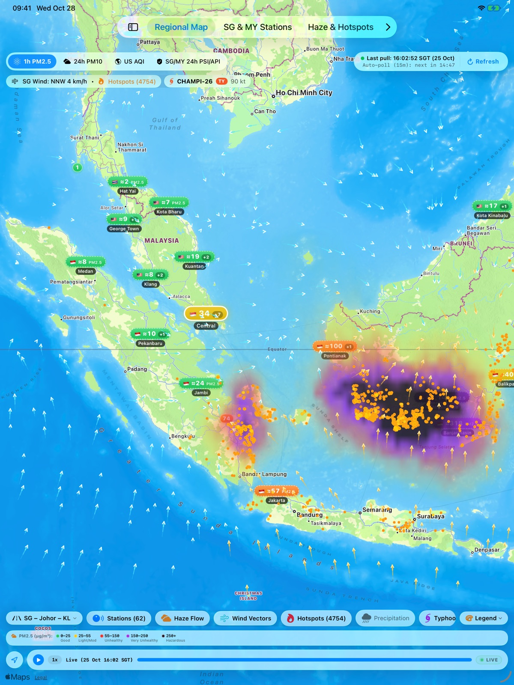
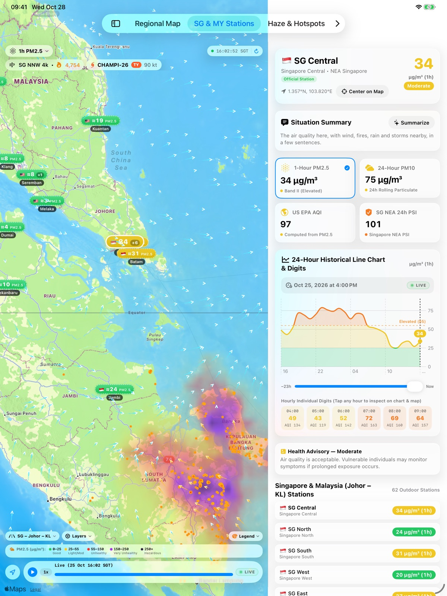
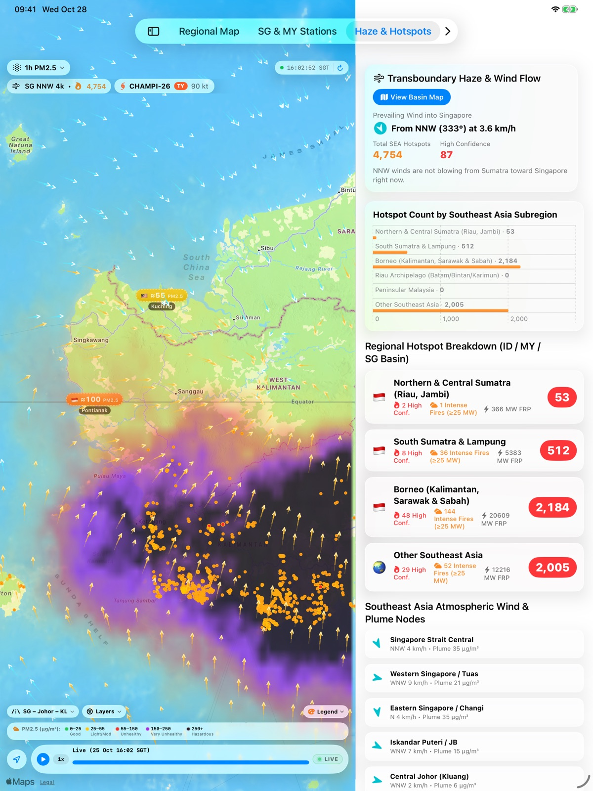

# SEA Haze — Tangkapan Skrin iPad

[English](ipad.md) · [华文](ipad.zh-Hans.md) · **Bahasa Melayu** · [தமிழ்](ipad.ta.md)

[← Kembali ke halaman sokongan](../../README.ms.md)

## Landskap

 Jerebu, titik panas kebakaran dan angin di Sumatera, Malaysia, Singapura dan Borneo

 Butiran stesen dengan PM2.5, PSI dan carta 24 jam

 Titik panas mengikut kawasan dan angin ke arah Singapura

 Laluan, ramalan dan jejari angin siklon tropika

## Potret

<table>
  <tr>
    <td align="center" valign="top" width="33%"> Jerebu, titik panas kebakaran dan angin di Sumatera, Malaysia, Singapura dan Borneo</td>
    <td align="center" valign="top" width="33%"> Butiran stesen dengan PM2.5, PSI dan carta 24 jam</td>
    <td align="center" valign="top" width="33%"> Titik panas mengikut kawasan dan angin ke arah Singapura</td>
  </tr>
</table>

Tangkapan skrin menunjukkan data sebenar pada 25 Oktober 2026.

**Peranti lain:** [iPhone](iphone.ms.md) · [iPhone Duo](iphone-duo.ms.md) · [Mac](mac.ms.md) · [Apple Vision Pro](vision-pro.ms.md) · [Apple Watch](apple-watch.ms.md)
