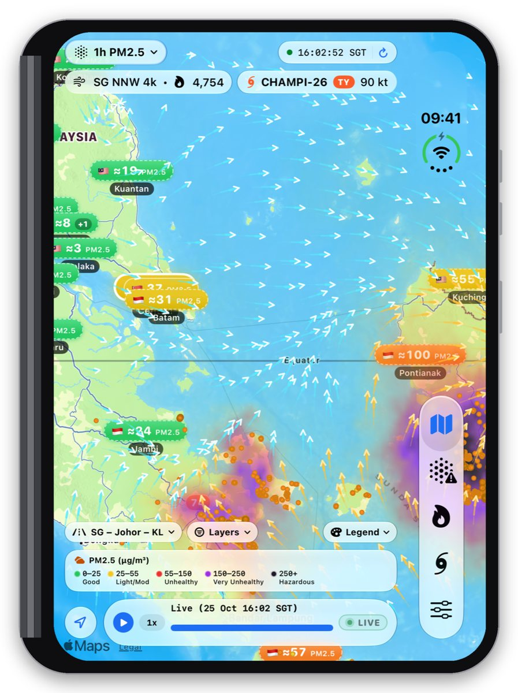
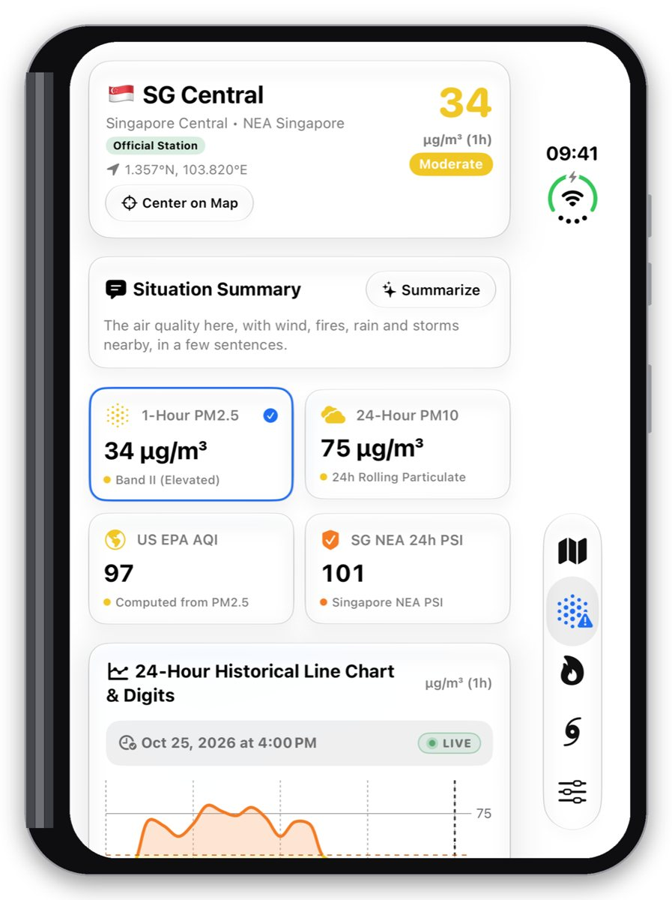
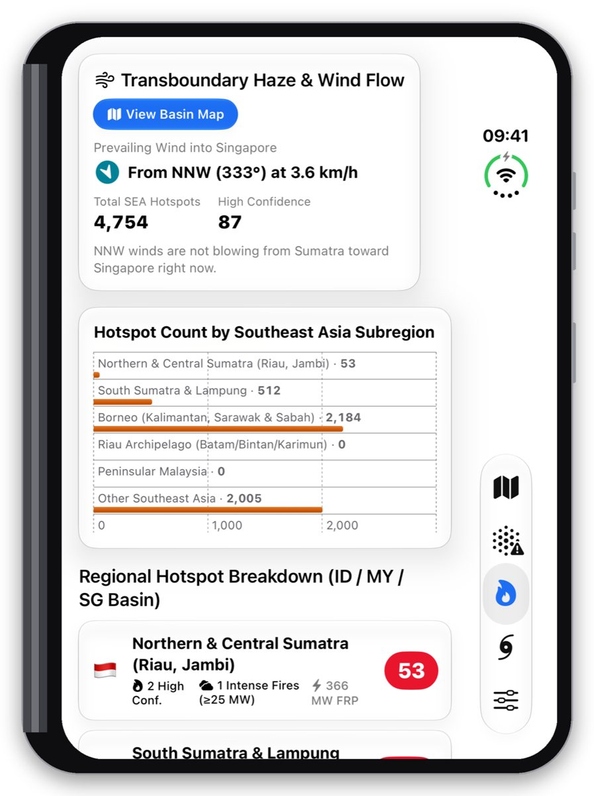
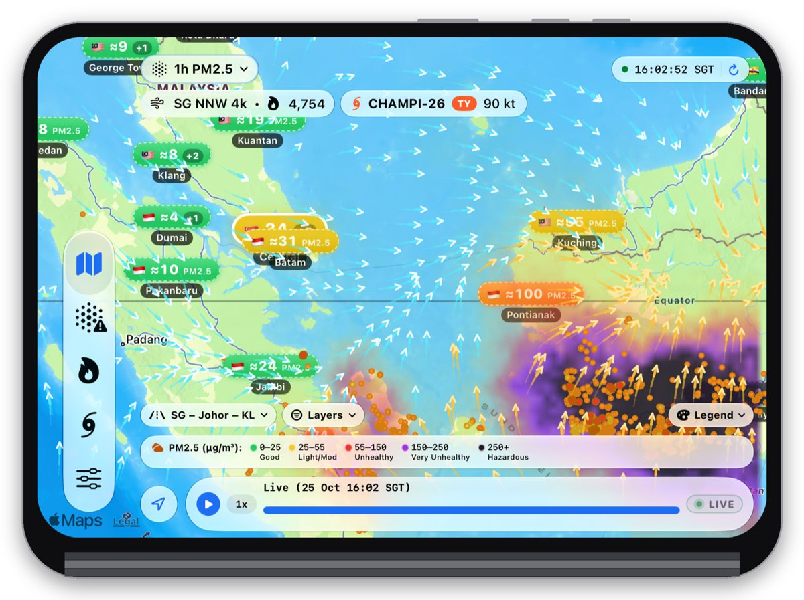
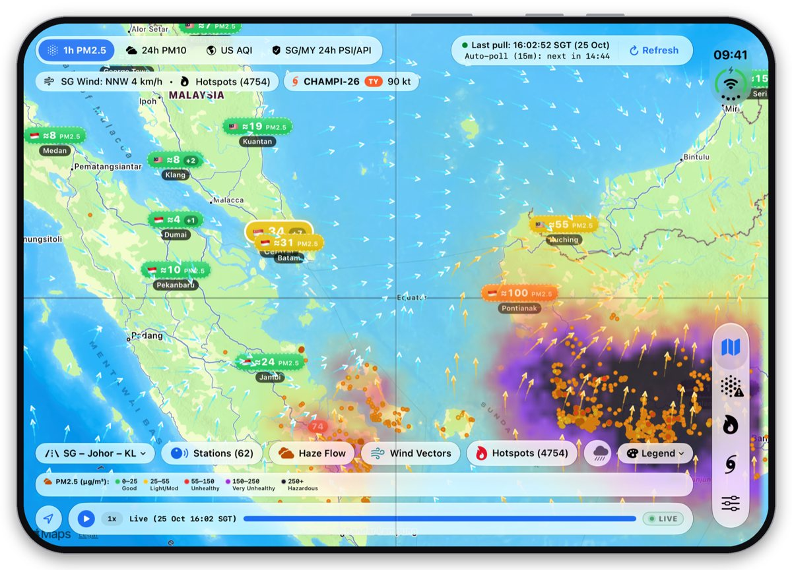
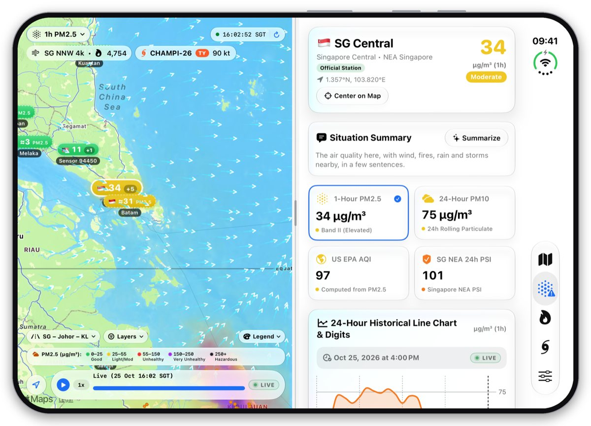
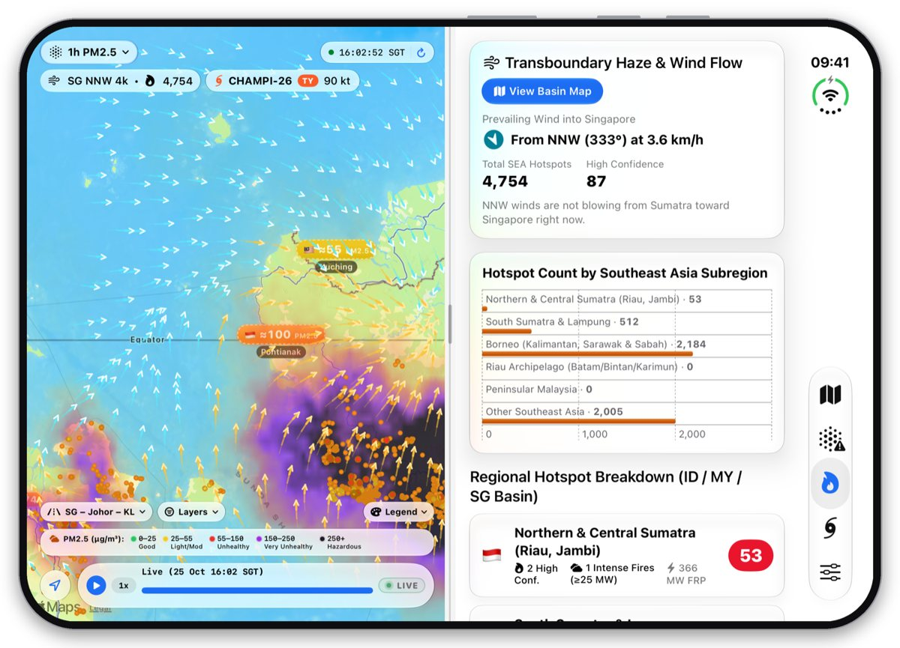
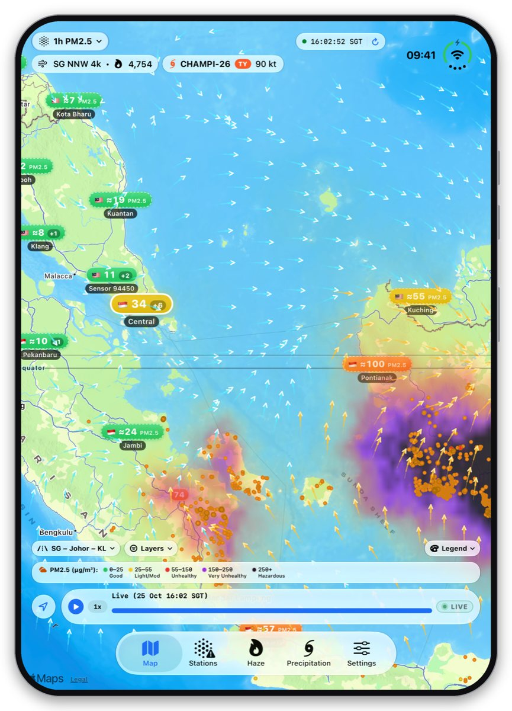
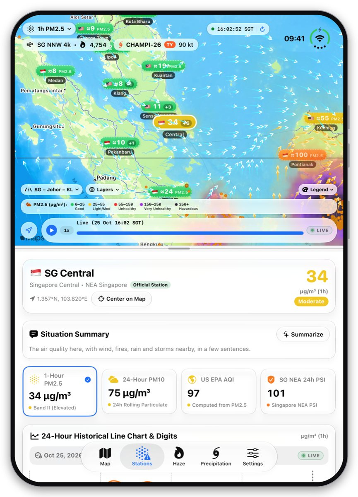
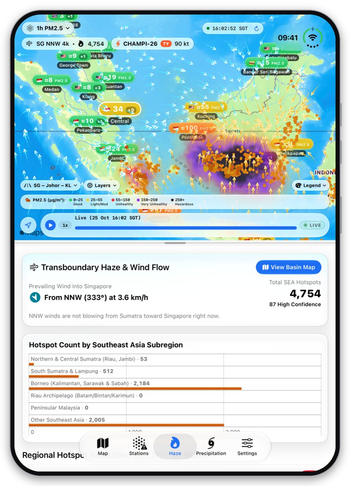

# SEA Haze — iPhone Duo 截图

[English](iphone-duo.md) · **华文** · [Bahasa Melayu](iphone-duo.ms.md) · [தமிழ்](iphone-duo.ta.md)

[← 返回支持页面](../../README.zh-Hans.md)

## 折叠 — 纵向

<table>
  <tr>
    <td align="center" valign="top" width="33%"> 苏门答腊、马来西亚、新加坡和婆罗洲的烟霾、火点和风场</td>
    <td align="center" valign="top" width="33%"> 监测站详情：PM2.5、PSI 及 24 小时图表</td>
    <td align="center" valign="top" width="33%"> 各地区火点数量及吹向新加坡的风</td>
  </tr>
</table>

## 折叠 — 横向

 苏门答腊、马来西亚、新加坡和婆罗洲的烟霾、火点和风场

## 展开 — 横向（地图与面板并排）

 苏门答腊、马来西亚、新加坡和婆罗洲的烟霾、火点和风场

 监测站详情：PM2.5、PSI 及 24 小时图表

 各地区火点数量及吹向新加坡的风

## 展开 — 纵向（地图在面板上方）

<table>
  <tr>
    <td align="center" valign="top" width="33%"> 苏门答腊、马来西亚、新加坡和婆罗洲的烟霾、火点和风场</td>
    <td align="center" valign="top" width="33%"> 监测站详情：PM2.5、PSI 及 24 小时图表</td>
    <td align="center" valign="top" width="33%"> 各地区火点数量及吹向新加坡的风</td>
  </tr>
</table>

截图显示的是 2026 年 10 月 25 日的真实数据。

**其他设备:** [iPhone](iphone.zh-Hans.md) · [iPad](ipad.zh-Hans.md) · [Mac](mac.zh-Hans.md) · [Apple Vision Pro](vision-pro.zh-Hans.md) · [Apple Watch](apple-watch.zh-Hans.md)
