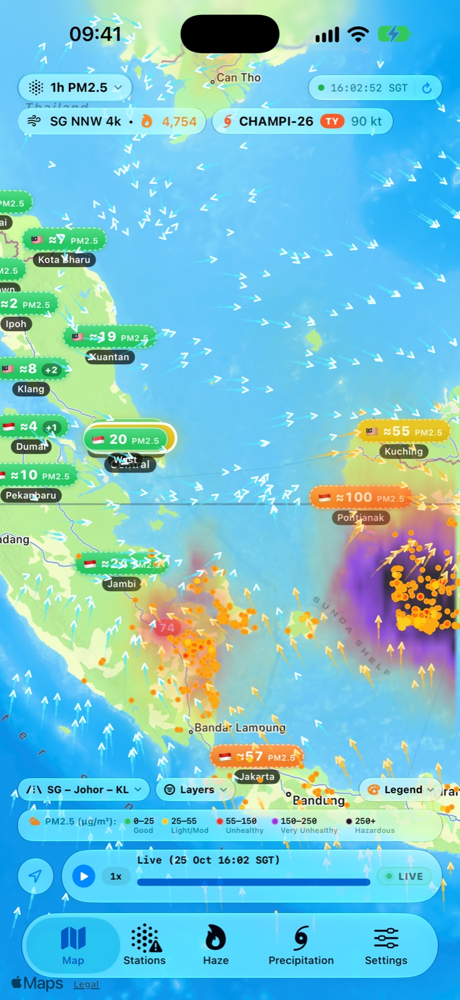
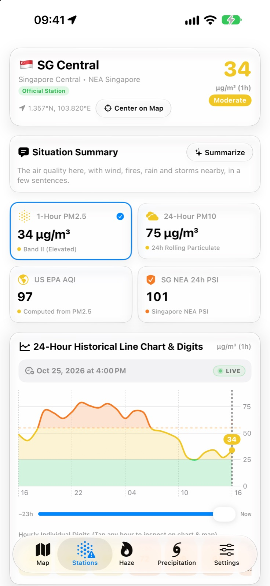
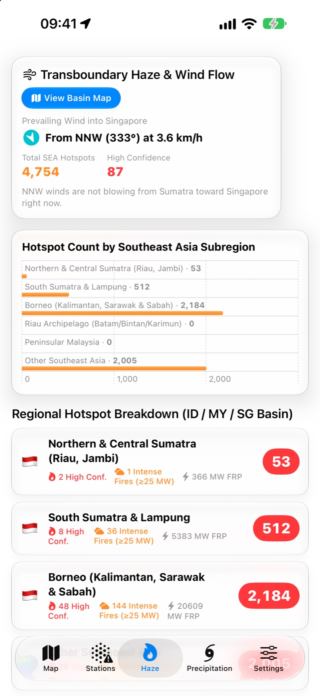
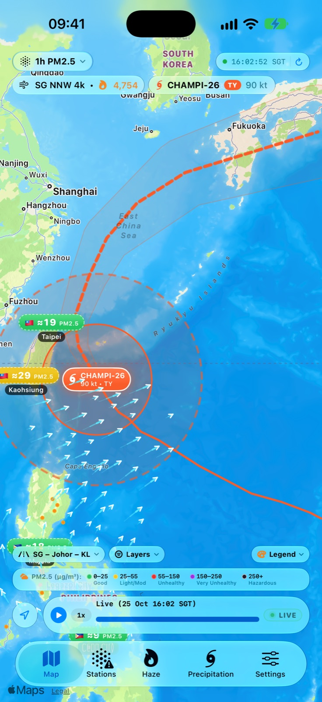

# SEA Haze — Tangkapan Skrin iPhone

[English](iphone.md) · [华文](iphone.zh-Hans.md) · **Bahasa Melayu** · [தமிழ்](iphone.ta.md)

[← Kembali ke halaman sokongan](../../README.ms.md)

<table>
  <tr>
    <td align="center" valign="top" width="50%"> Jerebu, titik panas kebakaran dan angin di Sumatera, Malaysia, Singapura dan Borneo</td>
    <td align="center" valign="top" width="50%"> Butiran stesen dengan PM2.5, PSI dan carta 24 jam</td>
  </tr>
  <tr>
    <td align="center" valign="top" width="50%"> Titik panas mengikut kawasan dan angin ke arah Singapura</td>
    <td align="center" valign="top" width="50%"> Laluan, ramalan dan jejari angin siklon tropika</td>
  </tr>
</table>

Tangkapan skrin menunjukkan data sebenar pada 25 Oktober 2026.

**Peranti lain:** [iPad](ipad.ms.md) · [Mac](mac.ms.md) · [Apple Vision Pro](vision-pro.ms.md) · [Apple Watch](apple-watch.ms.md)
