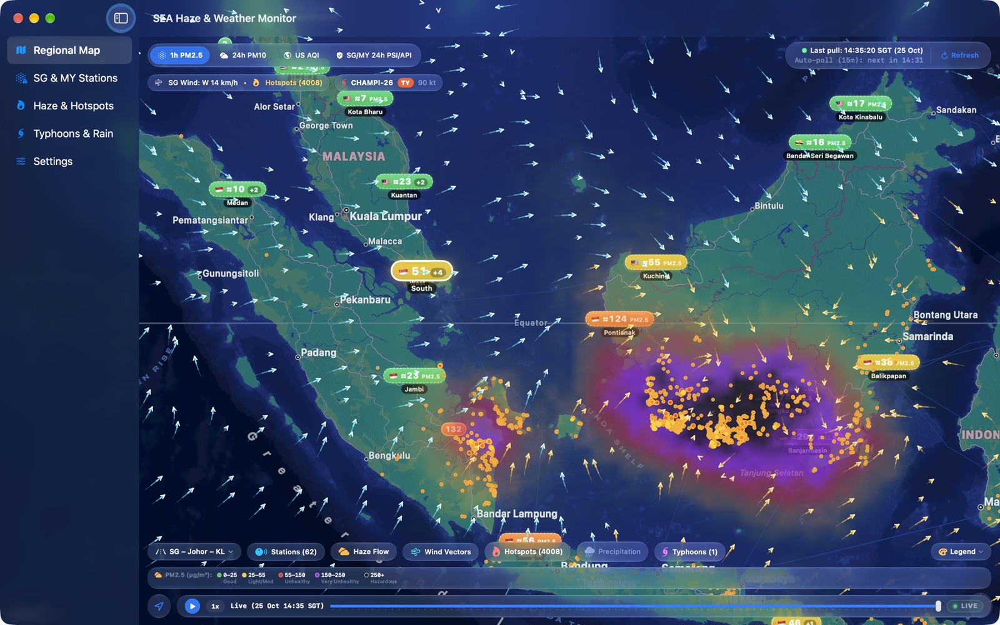
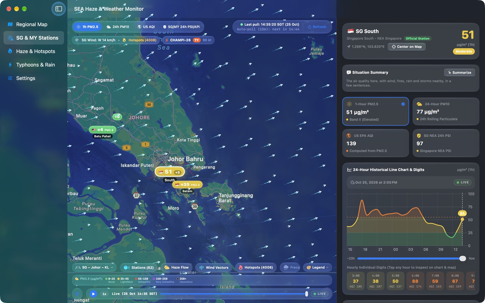
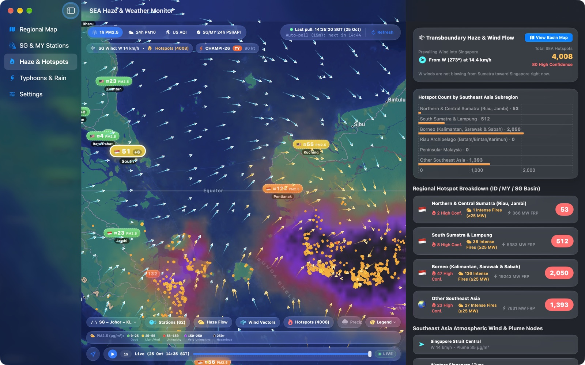
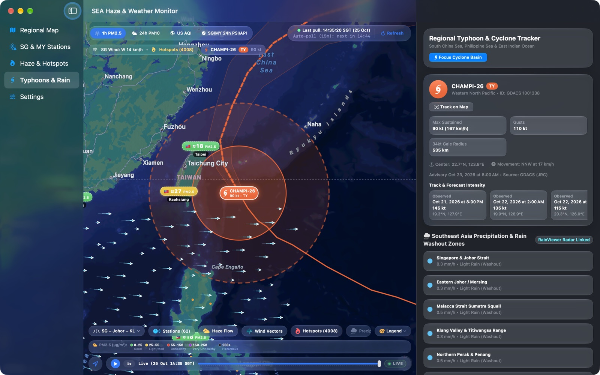

# SEA Haze — Mac 截图

[English](mac.md) · **华文** · [Bahasa Melayu](mac.ms.md) · [தமிழ்](mac.ta.md)

[← 返回支持页面](../../README.zh-Hans.md)

 苏门答腊、马来西亚、新加坡和婆罗洲的烟霾、火点和风场

 监测站详情：PM2.5、PSI 及 24 小时图表

 各地区火点数量及吹向新加坡的风

 热带气旋路径、预测及风圈

截图显示的是 2026 年 10 月 25 日的真实数据。

**其他设备:** [iPhone](iphone.zh-Hans.md) · [iPhone Duo](iphone-duo.zh-Hans.md) · [iPad](ipad.zh-Hans.md) · [Apple Vision Pro](vision-pro.zh-Hans.md) · [Apple Watch](apple-watch.zh-Hans.md)
